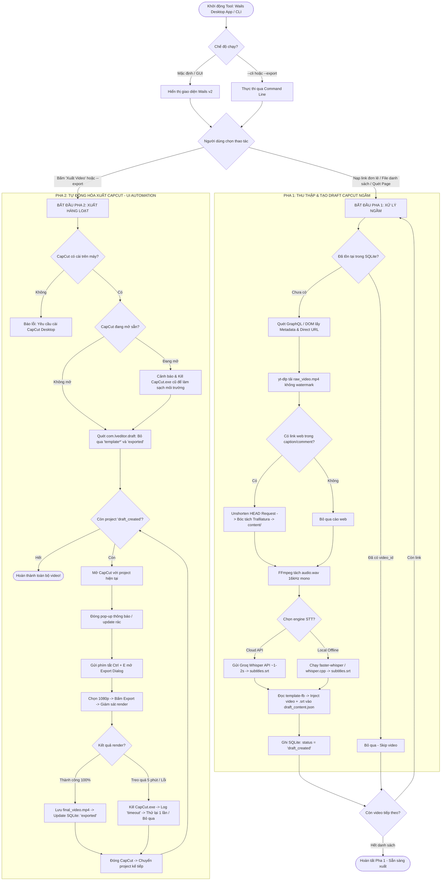
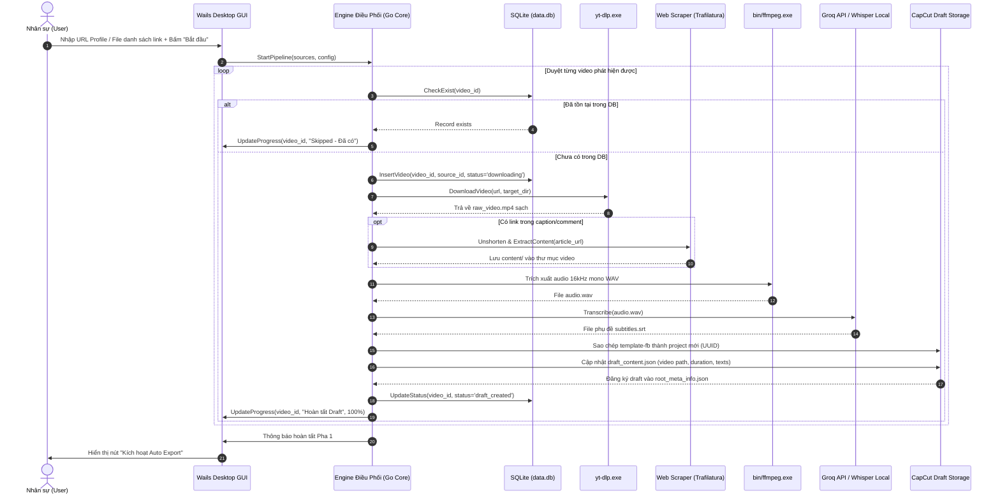
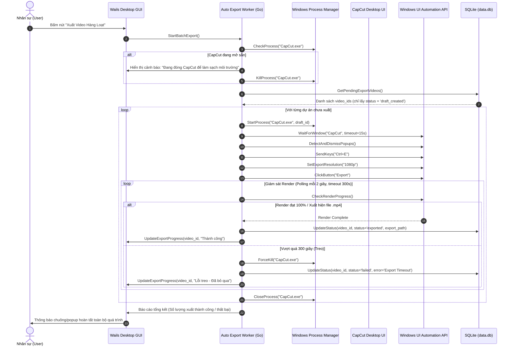

# 05 - Sơ Đồ Luồng Tổng Thể Hệ Thống (System Flowchart & Sequence Diagram)

> **Mục tiêu:** Trực quan hóa toàn bộ luồng hoạt động (End-to-End Pipeline) của hệ thống bằng sơ đồ chuẩn Mermaid, giúp lập trình viên và các bên liên quan nắm bắt kiến trúc xử lý 2 pha trong 30 giây.

---

## 1. Sơ đồ luồng hoạt động tổng quan (Overall Flowchart)

---

## 2. Sơ đồ tuần tự tương tác (Sequence Diagram) - Pha 1: Crawl & Inject

---

## 3. Sơ đồ tuần tự tương tác (Sequence Diagram) - Pha 2: Auto Export

