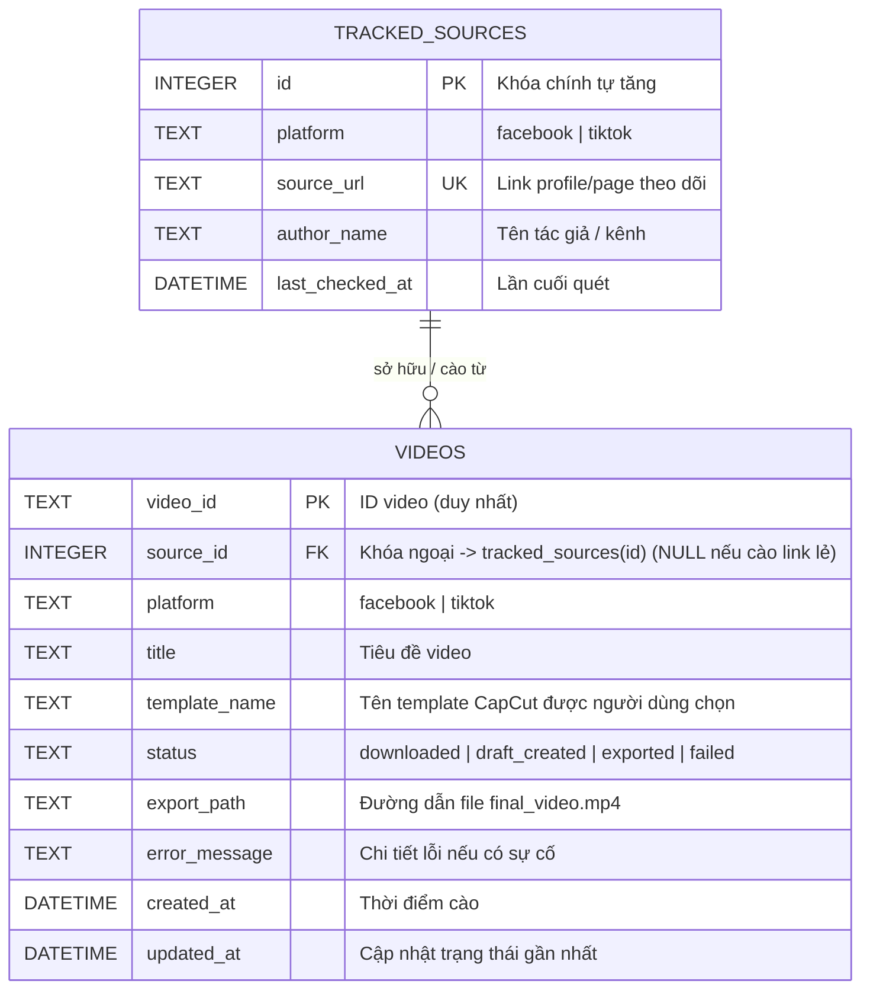

# Feature 02: Quản Lý & Lưu Trữ Dữ Liệu (Data Storage & History)

> **Mục tiêu:** Định nghĩa cách tổ chức lưu trữ các tệp đã tải và quản lý lịch sử để không bị trùng lặp dữ liệu khi chạy lại nhiều lần.

---

### 1. Cơ cấu tổ chức thư mục lưu trữ (Folder Architecture)

Dữ liệu của từng video/task sẽ được gom gọn vào thư mục `downloads/` theo cấu trúc chuẩn:

```text
downloads/
└── {platform}_{video_id}/
    ├── raw_video.mp4               # Video gốc tải về (không watermark)           
    ├── subtitles.srt               # File phụ đề đồng bộ mốc thời gian
    ├── metadata.json               # Toàn bộ thông tin: caption, link.
    │
    ├── content/                    # Thư mục lưu nội dung cào được từ liên kết
    │   ├── summary.json            # Thông tin trang web cào được (Title, URL gốc, type)
    │   ├── full_article.txt        # (Nếu là dạng One-page)
    │   ├── chapters/               # (Nếu là dạng Chapter)
    │      ├── chapter_01.txt
    │      ├── chapter_02.txt
    │      ├── chapter_03.txt
    │      └── full_article.txt    # Tổng hợp toàn bộ chapter lại.
    │
    └── exported/                   # Chứa video thành phẩm sau khi chạy Pha 2 (Auto Export)
        └── final_video.mp4         # Sản phẩm cuối cùng.
```

---

### 2. Kiểm tra trùng lặp (Deduplication)
*Nếu người dùng chạy lại một link hoặc quét một kênh đã từng tải trước đây:*
- [x] Bỏ qua (Skip) nếu video/bài viết đó đã tải thành công trước đó.
*Dấu hiệu để nhận diện trùng lặp:* ID bài viết (`video_id`) / URL / Mã băm (hash).

---

### 3. Cơ sở dữ liệu SQLite & Mô hình Quan hệ (SQLite Schema & ERD)

Hệ thống sử dụng SQLite (`data.db`) với thư viện Pure-Go `modernc.org/sqlite` (không cần cài CGO/gcc). Mô hình quan hệ giữa Kênh theo dõi (`tracked_sources`) và Video (`videos`) được thiết kế theo quan hệ 1-N (Một kênh có nhiều video; video cào từ link lẻ độc lập sẽ có `source_id = NULL`):

#### Sơ đồ thực thể quan hệ (ERD):



#### Bảng 1: `tracked_sources` (Danh sách Page / Kênh cần theo dõi)
| Cột | Kiểu dữ liệu | Ràng buộc | Mô tả |
| :--- | :--- | :--- | :--- |
| `id` | INTEGER | PRIMARY KEY AUTOINCREMENT | Khóa chính của nguồn kênh |
| `platform` | TEXT | NOT NULL | `facebook` hoặc `tiktok` |
| `source_url` | TEXT | UNIQUE NOT NULL | Link profile/page cần theo dõi định kỳ |
| `author_name` | TEXT | NULL | Tên tác giả / tên kênh hiển thị |
| `last_checked_at` | DATETIME | NULL | Thời điểm quét kiểm tra video mới gần nhất |

#### Bảng 2: `videos` (Lưu lịch sử video, chống trùng lặp & quản lý trạng thái)
| Cột | Kiểu dữ liệu | Ràng buộc | Mô tả |
| :--- | :--- | :--- | :--- |
| `video_id` | TEXT | PRIMARY KEY | ID định danh video (Ví dụ: `1029384756`) - chống trùng |
| `source_id` | INTEGER | NULL, REFERENCES `tracked_sources(id)` ON DELETE SET NULL | Liên kết tới nguồn cào (bằng `NULL` nếu nhập link đơn lẻ) |
| `platform` | TEXT | NOT NULL | `facebook` hoặc `tiktok` |
| `title` | TEXT | DEFAULT '' | Tiêu đề video hoặc ID |
| `template_name` | TEXT | DEFAULT 'template' | Tên template CapCut áp dụng (tùy người dùng chọn từ các dự án có từ 'template') |
| `status` | TEXT | NOT NULL | Trạng thái: `downloaded` ➔ `draft_created` ➔ `exported` (hoặc `failed`) |
| `export_path` | TEXT | NULL | Đường dẫn file video thành phẩm (`final_video.mp4`) |
| `error_message` | TEXT | NULL | Chi tiết lỗi nếu có sự cố (dùng ghi log và retry) |
| `created_at` | DATETIME | DEFAULT CURRENT_TIMESTAMP | Thời điểm thêm video vào hệ thống |
| `updated_at` | DATETIME | DEFAULT CURRENT_TIMESTAMP | Thời điểm cập nhật trạng thái gần nhất |

> ⚠️ **Lưu ý về dung lượng:** Database SQLite **hoàn toàn KHÔNG lưu trữ file video hay dữ liệu nặng (BLOB)**. DB chỉ lưu metadata và chuỗi trạng thái ngắn gọn để đối chiếu trùng lặp tức thì (dung lượng file `data.db` chỉ vài chục KB dù có lưu hàng chục nghìn video). File video `.mp4` hoàn chỉnh chỉ được lưu trực tiếp trên ổ cứng trong thư mục `downloads/`.

* **Cơ chế phát hiện video mới:** Khi quét một profile Facebook/TikTok, tool chỉ cần truy vấn nhanh: `SELECT 1 FROM videos WHERE video_id = ?`. Nếu đã có ID thì bỏ qua ngay (Skip), nếu chưa có ID thì mới bắt đầu tải về.

---

### 4. Hiển thị tiến trình trực quan (Console Live Progress)
Hệ thống hiển thị trạng thái theo thời gian thực để nhân sự theo dõi:
```text
[12/250] Đang quét Page: https://facebook.com/example_page...
├── [ℹ] Phát hiện 3 video mới chưa tải!
├── [✓] Đang tải video fb_109283741 (raw_video.mp4)
├── [✓] Đã bóc tách 3 chapters nội dung web
├── [⟳] Đang tạo phụ đề (Whisper Local: 45%)...
└── [✓] Đã tạo CapCut project: "Dự án fb_109283741"
```

---

### 5. Điều Kiện Nghiệm Thu (Acceptance Criteria)
- [ ] Khởi tạo tự động file SQLite `data.db` với đầy đủ 2 bảng và foreign key `source_id` ngay lần đầu chạy tool.
- [ ] Khi nhập 1 link đơn lẻ trực tiếp, bản ghi `videos` được tạo với `source_id = NULL`.
- [ ] Khi quét từ profile đã lưu, các video mới tải về liên kết chính xác với `source_id` của profile đó.
- [ ] Khi chạy lại cùng 1 link hoặc quét lại page cũ, các video đã có trong DB tự động bị bỏ qua trong < 10ms.
- [ ] Thư mục `downloads/{platform}_{video_id}/` được tạo đúng cấu trúc phân cấp, không bị phân tán file ra ngoài.
